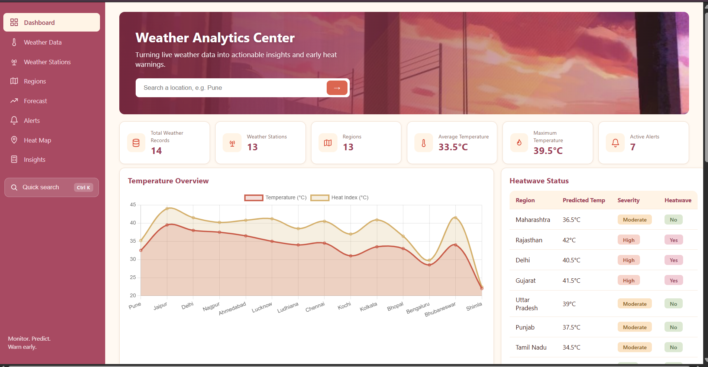
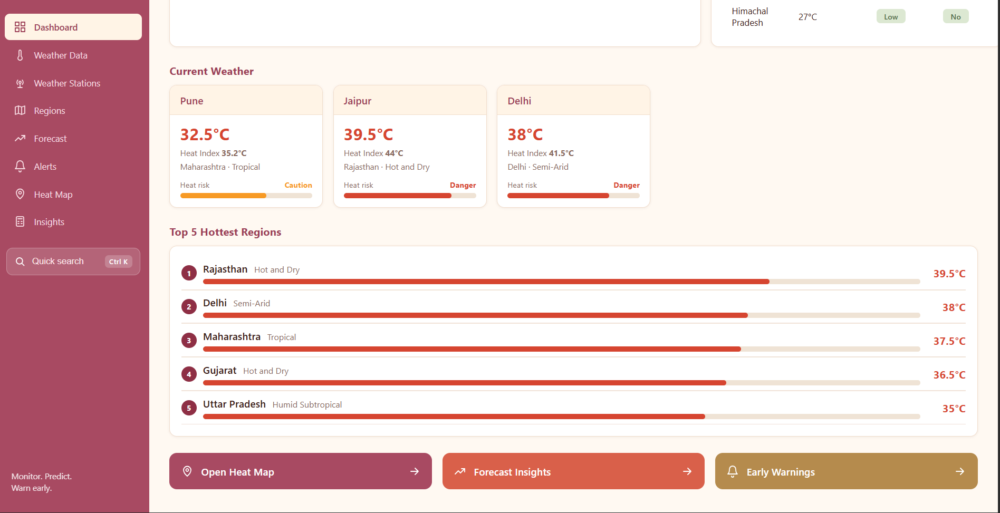
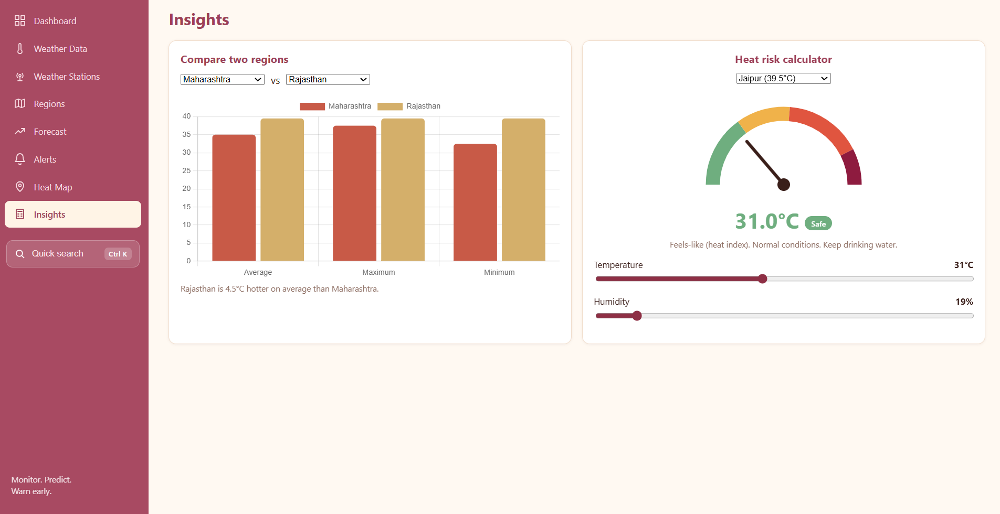
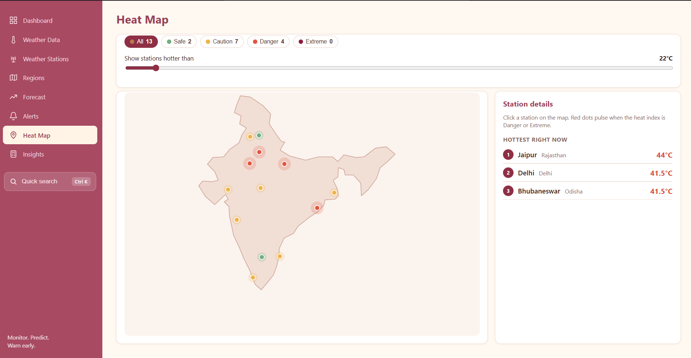
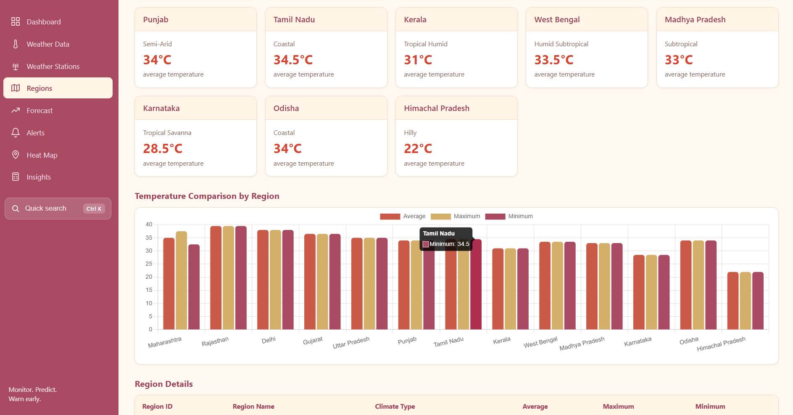

🌦️ WeatherWise — Weather Monitoring & Heatwave Prediction System

  <b>A college project for weather analytics, regional monitoring, and heatwave information.</b>

📸 Project Preview

  

<i>WeatherWise dashboard — overview of weather information and analytics.</i>
🖼️ More Screenshots
<table>
  <tr>
    <td align="center">
      <b>Dashboard Details</b> 
      
    </td>
    <td align="center">
      <b>Heat Index</b> 
      
    </td>
  </tr>
  <tr>
    <td align="center">
      <b>Heat Map</b> 
      
    </td>
    <td align="center">
      <b>Region Analysis</b> 
      
    </td>
  </tr>
</table>📌 About the Project
WeatherWise is a weather monitoring and heatwave information system that presents weather data through a web-based analytics dashboard.

The application uses a Flask backend connected to a PostgreSQL database. Users can explore weather records, temperature trends, regional information, weather stations, forecasts, and alerts through the dashboard.
✨ Features
- 📊 Weather analytics dashboard with summary cards and visualizations
- 🌡️ Temperature and heat-index information
- 🔎 Search and filter weather records
- 📄 Paginated weather data
- 📥 CSV export
- 🗺️ Regional temperature analysis
- 📡 Weather station information
- 🔥 Forecast and severity information
- 🚨 Alert monitoring
Note: Forecast and alert information depends on the records available in the configured database. The application does not automatically train a new prediction model.

🛠️ Tech Stack
Technology	Purpose
Python	Backend application logic
Flask	Web server and API endpoints
PostgreSQL	Weather and related data storage
HTML, CSS, JavaScript	Frontend interface
Chart.js	Data visualizations
Git & GitHub	Version control

📂 Project Structure
Mini-project/
├── README.md
└── weather-flask/
    ├── app.py
    ├── requirements.txt
    ├── test_api.py
    ├── README.md
    ├── Screenshot/
    │   ├── Dashboard.png
    │   ├── Dashboard2.png
    │   ├── HeatIndex.png
    │   ├── Heatmap.png
    │   └── Region.png
    └── static/
        ├── index.html
        ├── style.css
        ├── app.js
        └── img/
⚙️ Run Locally
1. Open the weather-flask folder in PyCharm.
2. Open the terminal in that folder.
3. Create a virtual environment:
   python -m venv .venv
4. Activate it on Windows PowerShell:
   .venv\Scripts\Activate.ps1
5. Install dependencies:
   pip install -r requirements.txt
6. Configure PostgreSQL and make sure the database and required tables are available.
7. Start the application:
   python app.py
8. Open http://localhost:5000 in your browser.
👩‍💻 Author
Sanskruti Sonawane
- GitHub: @ssanskruti17-tech

Built as a learning project using Python, Flask, PostgreSQL, and web technologies.

